# Microsoft Fabric Medallion Lakehouse for Dynamics 365 ERP & Dataverse

[](https://learn.microsoft.com/users/me/credentials)
[](https://fabric.microsoft.com/)
[-E95420?style=for-the-badge&logo=apachespark&logoColor=white)](https://delta.io/)
[](https://powerbi.microsoft.com/)
[](LICENSE)

An end-to-end, enterprise-grade data engineering implementation on **Microsoft Fabric** that ingests, cleans, normalizes, and transforms mission-critical **Microsoft Dynamics 365 (Business Central / Finance & Operations / Dataverse)** ERP data into a high-performance **Medallion Lakehouse**, served directly to **Power BI via Direct Lake Mode** with zero import latency and zero API timeouts.

---

## 🎯 The Enterprise Business Problem

Organizations running Dynamics 365 ERP alongside Power BI frequently experience major reporting failures when connecting directly via OData or REST APIs:
1. **API Throttling & Morning Refresh Timeouts**: Heavy queries against live General Ledger (`G/L Entry`), Sales Invoice, and Customer tables trigger Dataverse API service protection limits, causing scheduled morning refreshes to fail.
2. **Cryptic Option Sets & Schema Complexity**: Dataverse stores status codes and choice values as raw integers (e.g., `statuscode = 282410001` instead of `"Approved"` or `"In Review"`), requiring complex, repeated joins across `stringmap` tables.
3. **Timezone & Currency Mismatches**: Financial postings stored in UTC create month-end cutoff discrepancies for regional subsidiaries (e.g., East Africa Time, UTC+3), while multi-currency ledger transactions lack centralized exchange rate normalization.
4. **Data Import Redundancy**: Traditional Power BI import models duplicate gigabytes of ERP data, increasing cloud storage costs and refresh delays.

---

## 🏗️ Architecture: Microsoft Fabric Medallion Pattern

This repository implements the unified **OneLake Medallion Architecture** recommended by Microsoft for enterprise Fabric deployments:

```mermaid
flowchart LR
    subgraph Source["ERP Operational Layer"]
        D365["Dynamics 365 Business Central / F&O"]
        DV["Dataverse Tables\n(Accounts, Orders, Invoices, G/L)"]
    end

    subgraph FabricOneLake["Microsoft Fabric OneLake Unified Storage"]
        subgraph Bronze["🥉 Bronze Layer (Raw Replicated)"]
            B1["OneLake Shortcut / Synapse Link"]
            B2["Raw Delta Parquet Files"]
            B3["Metadata & StringMap Tables"]
        end

        subgraph Silver["🥈 Silver Layer (Cleansed & Enriched)"]
            S1["PySpark Cleaning Notebooks"]
            S2["Option-Set Resolution (Decoded Choice Labels)"]
            S3["Timezone Standardization (UTC -> EAT)"]
            S4["SCD Type 1 & Type 2 Deduplication"]
        end

        subgraph Gold["🥇 Gold Layer (Curated Dimensional Star Schema)"]
            G1["FactGeneralLedger (Financial Postings)"]
            G2["FactSales (Invoiced Revenue & Margins)"]
            G3["DimCustomer & DimAccount"]
            G4["DimDate (Fiscal Calendar)"]
            G5["Delta Lake Z-Order Optimization"]
        end
    end

    subgraph Consumption["Analytics & BI Consumption"]
        DL["Power BI Semantic Model\n(Direct Lake Mode)"]
        KQL["Real-Time Analytics / Eventhouse\n(KQL Telemetry & Alerts)"]
        Dashboard["Executive Financial Dashboards\n(Sub-Second Queries, Zero Refresh Lag)"]
    end

    Source -->|"Link to Fabric (Zero-ETL)"| Bronze
    Bronze -->|"Fabric PySpark Notebooks"| Silver
    Silver -->|"Fabric Delta Transformations"| Gold
    Gold -->|"Direct Lake (In-Memory Parquet)"| DL
    DL --> Dashboard
    Gold -.->|"Streaming Alerts"| KQL
```



---

## 📂 Repository Structure

```
fabric-d365-medallion-lakehouse/
├── README.md                              # Technical documentation & architectural guide
├── notebooks/                             # Production-grade Fabric PySpark notebooks
│   ├── 01_bronze_ingestion_dataverse.py   # Ingestion, validation & OneLake shortcut hydration
│   ├── 02_silver_pyspark_cleaning_d365.py # Option-set decoding, typing, UTC->EAT timezone conversion
│   ├── 03_gold_star_schema_delta.py       # Star schema modeling (Facts & Dims) + Z-Ordering
│   └── 04_lakehouse_maintenance.py        # Delta maintenance (VACUUM, OPTIMIZE, file compaction)
├── pipelines/                             # Fabric Data Factory Declarative Pipelines
│   └── fabric_pipeline_d365_refresh.json  # Orchestration pipeline with failure alerts & retries
├── semantic-models/                       # Power BI Direct Lake artifacts
│   ├── direct_lake_model.bim              # Tabular Model definition for Direct Lake semantic model
│   └── dax_kpis_and_measures.dax          # Pre-built enterprise DAX measures (YTD, GP%, Variance)
├── kql/                                   # Real-Time Intelligence & Eventhouse
│   └── eventhouse_erp_telemetry.kql       # KQL queries for real-time transaction ingestion & SLA monitoring
├── dataverse-metadata/                    # Metadata dictionary
│   ├── stringmap_optionsets.json          # Standard Dynamics 365 option-set integer-to-string mappings
│   └── d365_schema_definitions.json       # ERP entity definitions
└── sample-data/                           # Anonymized synthetic ERP test datasets
    ├── raw_customers.json
    ├── raw_general_ledger_entries.json
    └── raw_sales_invoices.json
```

---

## ⚡ Technical Highlights & DP-700 Competencies

### 1. Zero-Copy Ingestion with Link to Fabric
Instead of scheduled high-impact API extract jobs, tables are mirrored into **OneLake** using **Link to Microsoft Fabric** (or Azure Synapse Link for Dataverse). Operational changes in Dynamics 365 appear as Delta Parquet in the Bronze layer within seconds without consuming ERP compute.

### 2. PySpark Cleaning & Option-Set Decoding (Silver)
Dynamics 365 represents categorical fields as integer codes. Notebook `02_silver_pyspark_cleaning_d365.py` performs broadcast joins against `stringmap` tables to materialize readable business dimensions:
```python
# Decoding Dynamics 365 payment terms and invoice statuses
df_cleaned = (
    df_raw.join(F.broadcast(df_stringmap), 
                (df_raw["statuscode"] == df_stringmap["attributevalue"]) & 
                (df_stringmap["attributename"] == "statuscode") &
                (df_stringmap["objecttypecode"] == "salesorder"), 
                "left")
    .withColumn("status_name", F.coalesce(F.col("value"), F.lit("Unknown")))
    .withColumn("posting_date_eat", F.from_utc_timestamp(F.col("createdon"), "Africa/Nairobi"))
)
```

### 3. Star Schema Modeling & Z-Order Optimization (Gold)
Gold tables are organized into a strict Star Schema:
* **`FactGeneralLedger`**: Partitioned by `FiscalYear` and `FiscalPeriod`, with Z-Ordering applied on `[AccountKey, CostCenterKey]` to optimize query pruning.
* **`FactSales`**: Transactional granularity at the invoice line level with unified customer keys.
* **`DimDate`**: 4-4-5 / Gregorian fiscal calendar mapping for year-over-year comparisons.

### 4. Direct Lake Mode in Power BI
Power BI semantic models connect directly to Gold Delta tables in OneLake via **Direct Lake Mode**. 
* **Zero Data Duplication**: The Power BI VertiPaq engine loads Delta Parquet columns straight from OneLake storage into memory on demand.
* **No Refresh Lag**: As soon as the Silver/Gold PySpark notebook completes, reports instantly reflect updated numbers without scheduling dataset refreshes in Power BI Service.

---

## 🚀 Getting Started on Microsoft Fabric

### Prerequisites
* Microsoft Fabric Capacity (Trial F64 or Production capacity).
* Workspace with **Data Engineering** and **Data Factory** workloads enabled.
* Access to a Dynamics 365 / Power Apps environment with Dataverse system administrator or customizer privileges.

### Deployment Steps
1. **Create Workspaces**: Provision `ws-d365-analytics-dev` in Microsoft Fabric.
2. **Link Dataverse to Fabric**:
   * In Power Apps Studio (`make.powerapps.com`), navigate to **Tables** → **Analyze** → **Link to Microsoft Fabric**.
   * Select target Fabric Workspace and Lakehouse (`lh_d365_bronze`).
3. **Import PySpark Notebooks**:
   * Upload `01_bronze_ingestion_dataverse.py`, `02_silver_pyspark_cleaning_d365.py`, and `03_gold_star_schema_delta.py` to your Fabric workspace.
4. **Deploy Pipeline**:
   * Import `pipelines/fabric_pipeline_d365_refresh.json` into Fabric Data Factory to automate scheduled runs.
5. **Connect Power BI via Direct Lake**:
   * Open `lh_d365_gold` → click **New Semantic Model** → select Gold Fact & Dimension tables → create Direct Lake measures using `semantic-models/dax_kpis_and_measures.dax`.

---

## 👨‍💻 Author

**Rooney Odhiambo**  
*Microsoft Certified: Fabric Data Engineer Associate (DP-700)*  
*Founder @ GovTech Builders KE | Co-Founder @ EduOne Africa*  
* Nairobi, Kenya  
* [LinkedIn](https://linkedin.com/in/rooney-odhiambo-9a26b6256) | [GitHub](https://github.com/KabuorJnr) | [Email](mailto:rooneyodhiambo2004@gmail.com)

---

## 📄 License
This project is licensed under the MIT License - see the [LICENSE](LICENSE) file for details.
